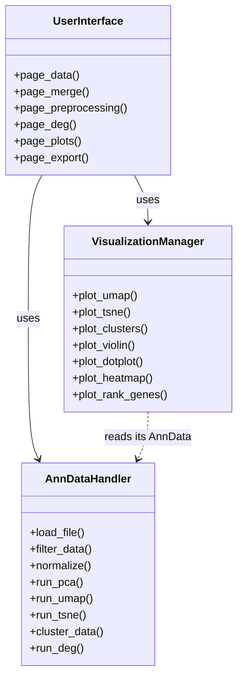
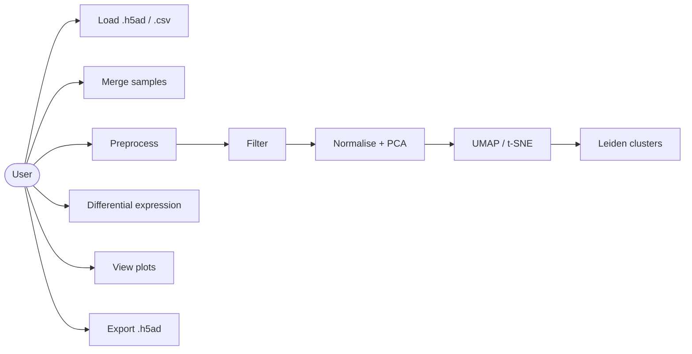

# scRNA-seq Pipeline App


A web app that lets biologists run a complete **single-cell RNA-seq analysis** (filtering → normalisation →
PCA → UMAP/t-SNE → Leiden clustering → differential expression → plots) from the browser, with no
programming. Built with **Streamlit** and **Scanpy**, and packaged with **Docker** so anyone can run it
with a single command.

> Originally a university project (*Software Technologies*, Department of Informatics, Ionian University),
> developed by Dimitris Konispoliatis and Aikaterini Analyti. Extended into a tested, containerised application.


## Features

| Page | What it does |
|---|---|
| **Data** | Upload `.h5ad` or `.csv` (cells × genes, or tick *transpose*), preview cell/gene metadata, or load a built-in synthetic demo dataset |
| **Merge** | Combine several `.h5ad` samples into one dataset; a `sample` column records each cell's origin (inner/outer gene join) |
| **Preprocessing** | Filter cells/genes, normalise + log1p, highly variable genes, scale, PCA, neighbours + UMAP, t-SNE, Leiden clustering (adjustable resolution) |
| **Differential expression** | Top-N marker genes per cluster (t-test or Wilcoxon), results table, CSV download, Scanpy ranking plot |
| **Plots** | UMAP/t-SNE coloured by cluster or gene, violin, dot plot and heat map; unknown gene names are reported instead of crashing |
| **Export** | Download the processed dataset (embeddings, clusters, DEG results) as `.h5ad` |

## Quick start

### Option A: Docker (no Python needed)

```bash
docker build -t scrna-app .
docker run -p 8501:8501 scrna-app
# open http://localhost:8501
```

To hand the image to someone without a registry:

```bash
docker save scrna-app -o scrna-app.tar      # on your machine
docker load -i scrna-app.tar                # on theirs
docker run -p 8501:8501 scrna-app
```

### Option B: local Python (3.10+)

```bash
python -m venv .venv
.venv\Scripts\activate          # Windows   (macOS/Linux: source .venv/bin/activate)
pip install -r requirements.txt
streamlit run main.py
```

No data at hand? Click **Load demo dataset** on the Data page: it generates a synthetic dataset with four
cell populations and known marker genes (`MARKER0_00`, ...), so you can try the whole pipeline in a minute.
A suggested walkthrough: *Data → Load demo → Preprocessing: Apply filter (min genes 50) → Normalise + PCA →
Compute UMAP → Run Leiden → Differential expression → Plots*.

## Architecture

The design follows the three components of the original class diagram. UI code never calls Scanpy
directly, and the backend never imports Streamlit.





Streamlit re-runs the script on every interaction, so the analysis state (an `AnnDataHandler` that owns the
`AnnData` object) lives in `st.session_state`.

### Project structure

```
main.py                 Streamlit entry point (sidebar navigation)
scrna_app/
  pages.py              UserInterface: one function per page
  pipeline.py           AnnDataHandler: all analysis steps (no Streamlit)
  plotting.py           VisualizationManager: Scanpy plots as matplotlib figures
  data_io.py            read / merge / export .h5ad and .csv
  demo.py               synthetic dataset generator
  utils.py              gene-name parsing and matching helpers
tests/                  pytest suite (planted-signal tests, see below)
Dockerfile, .streamlit/ container + server configuration
```

### Design decisions

- **Failure-safe steps.** Each processing step works on a copy and replaces the dataset only if it succeeds.
  A bad parameter never leaves a half-processed dataset.
- **Every gene stays plottable.** After normalisation the full log-normalised matrix is kept in `adata.raw`
  before subsetting to highly variable genes, so DEG and plots work for any gene, not only the top 2000.
- **Friendly input handling.** Gene lookup is case-insensitive (`ppy` finds `PPY`), missing genes are
  reported, groups with a single cell are skipped for DEG with a warning, and parameters such as
  neighbours or PCA components are capped to what the dataset can support.
- **Testable without real data.** The synthetic generator plants known cell populations and marker genes,
  so tests can assert that clustering recovers the groups and DEG ranks the planted markers.

## Tests

```bash
pip install -r requirements-dev.txt
pytest -q
```

Tests for the Scanpy-dependent code are skipped automatically if Scanpy is not installed.

## Notes and limitations

- Leiden clustering uses the `igraph` implementation (`flavor="igraph"`), which needs `python-igraph`
  (included in `requirements.txt`).
- Large datasets are processed in memory on the server; the upload limit is raised to 1 GB in
  `.streamlit/config.toml`.
- The course dataset used in the report is not redistributed here; use your own `.h5ad` or the demo data.

## Authors

Aikaterini Analyti, Dimitris Konispoliatis.
